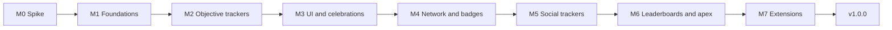

# Development roadmap

One file per milestone; each file lists the **development steps** of that milestone. A step is one branch and one pull request, shipped automatically with `tools/ship_step.py` when the local checks, the whole offline suite and CI are green ([ADR 0007](../adr/0007-git-flow-and-automated-shipping.md)). The short overview is in [ROADMAP.md](../../ROADMAP.md); the behaviour every step implements is in the [specification](../specs/README.md) (Italian).

| Milestone | File | Goal | Steps | Version |
|---|---|---|---|---|
| **M0** | [M0-spike.md](M0-spike.md) | Answer the risky API questions (V1-V21) in the real client with a probe addon | 9 | none (the probe is never distributed) |
| **M1** | [M1-foundations.md](M1-foundations.md) | Addon skeleton, offline tests, Core, Restrictions, Config, Ladder, Scoring, Ruleset, Ledger, Boost: points computed locally | 12 | `v0.1.0` |
| **M2** | [M2-objective-trackers.md](M2-objective-trackers.md) | Delver, Adventurer, Pathfinder, Artisan and the backfill | 10 | `v0.2.0` |
| **M3** | [M3-ui-celebrations.md](M3-ui-celebrations.md) | The ecosystem look, placeholder badges, main window, profile, history, settings, celebrations | 12 | `v0.3.0` |
| **M4** | [M4-network-badges.md](M4-network-badges.md) | Codec, transport, beacons, profiles, attestations, simulator; badges on tooltip, nameplates, frames, chat, menu | 13 | `v0.4.0` (public beta) |
| **M5** | [M5-social-trackers.md](M5-social-trackers.md) | Vanguard, Merchant, Commendations, Diplomat, Prestige Events, Steward, Hardcore memorial | 11 | `v0.5.0` |
| **M6** | [M6-leaderboards-apex.md](M6-leaderboards-apex.md) | Leaderboards, relays, weekly apex seats, consensus, reigns, Hall of Prestige, rewards | 12 | `v0.6.0` |
| **M7** | [M7-extensions-release.md](M7-extensions-release.md) | Public API, Prestige Contracts, adapters, guild and friends lists, final art, translation kit, full release check | 11 | `v1.0.0` |

## Order and dependencies



M1 may start on the specification's assumptions while the owner runs the probe: its modules are pure or behind Compat. M0.9 then revises what the results contradict, and M2.1 re-reads the results before any tracker is written.

## Rules of every milestone

1. **It opens with a specification step** (`M<N>.1`): the session re-reads the specs of the milestone and the results of earlier milestones, settles what the steps need (module interfaces, message formats, data shapes, the open questions that block them) and writes it into `docs/specs/` (Italian) and, for a new decision, an ADR.
2. **It closes with its in-game checklist** (`docs/checklists/M<N>.md`): what only the real client can confirm, written so that the owner can run it alone.
3. **A release-preparation step follows the checklist** (from M1): every switch of an unfinished feature is off ([ADR 0017](../adr/0017-feature-switches.md)), the changelog is promoted with `tools/release_notes.py --promote 0.<N>.0`, both READMEs and the wiki state the status, the Release workflow runs as a dry run. Then the coordinator makes the annotated tag with the noreply identity, pushes it, and checks the GitHub Release and its zip ([RELEASING](../RELEASING.md)).
4. **The first unticked step is always the next one**, and its checkboxes are ticked in its own pull request with a short *Done* note.
5. **No half-finished feature ships**: a step that lands ahead of its milestone stays behind its switch.

## Who runs a step: one fresh session per step

The coordinating session starts a new session for each step: fresh context, the same folder, no worktree, one at a time ([ADR 0018](../adr/0018-one-fresh-session-per-step.md)). The model and effort of each step are in the table at the top of its milestone file, chosen with this rule:

| Kind of step | Model | Effort |
|---|---|---|
| Specification, architecture, network protocol, protected or taint-sensitive APIs, security, data migrations | Opus | high |
| Non-trivial data logic | Opus | medium |
| UI views, standard features on existing foundations | Sonnet | medium |
| Features with many edge cases or heavy tests | Sonnet | high |
| Checklists, documentation, release preparation | Sonnet | low or medium |

The brief of every step session contains: "only this step"; the flow of [CLAUDE.md](../../CLAUDE.md); the ship command; the step's section of its milestone file; the specs to read; the feature switches to respect; "never `gh pr merge`"; "never run `tools/sync_wiki.py`"; "report in Italian: pull request, commit on `main`, number of tests, what was not verified in the game".

## How a step is written

```
### M<N>.<k> — Title
- Branch:      step/m<N>-<k>-<short-name>
- Model:       Opus · high        (from the table above)
- Depends on:  previous steps
- Spec:        the sections it implements
- Scope:       what it creates or changes
- Done when:   acceptance criteria (checkboxes), ticked in the step's own pull request
- Tests:       offline tests that must exist and pass
- Docs:        what to update in the same pull request
- Real client: what only the game can confirm (listed in the pull request as "not verified")
```

## Definition of done (every step)

- [ ] The acceptance criteria of the step are met and ticked, with a short *Done* note.
- [ ] `python -I -X utf8 tools/check_docs.py` and, from M1.3 on, the whole `python -X utf8 Tests/run_tests.py` pass locally and in CI.
- [ ] `CHANGELOG.md` ("Unreleased"), the affected specs and ADRs (and the ADR index), both READMEs when features or status change, and `docs/wiki/` in **both languages** for anything a user can see are updated in the same pull request.
- [ ] Every new visible string is a locale key in `enUS` and `itIT`.
- [ ] The pull request lists what was **not** verified in the real client.
- [ ] No personal data; every new API is checked against the Forever dump and guarded by Compat.
