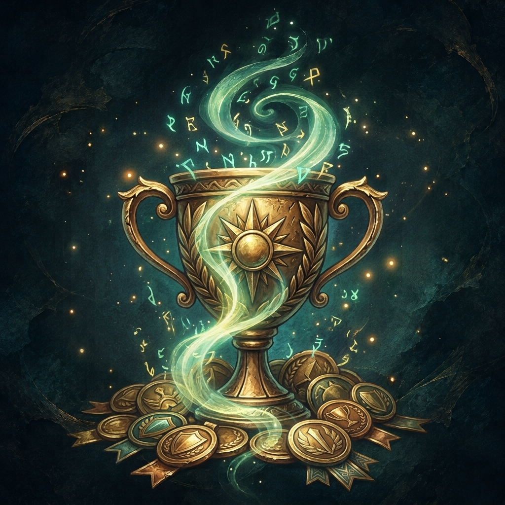

# About and credits

*Italiano: [[Informazioni e crediti|About-it]]*

**Azeroth Prestige** is created and designed by **Finland**. It belongs to a small family of addons for WoW Forever by the same author, which share one look: Azeroth Accord, Azeroth Unspoken and Finland Dragon Credit Points. Each one is independent: none needs the others.

## Licences

- The **code** is free software under the GNU GPL v3.0 or later.
- The **logo, badges, emblems and sounds** are all rights reserved: you may use them with the addon and show them in screenshots, videos and streams.
- This **manual** is under CC BY 4.0.

The details are in [LICENSING.md](https://github.com/Finland6738/azeroth-prestige/blob/main/LICENSING.md).

## Not affiliated with Blizzard

Azeroth Prestige is an unofficial fan project, free of charge, not affiliated with or endorsed by Blizzard Entertainment. World of Warcraft and Azeroth are trademarks of Blizzard Entertainment, Inc.

## Feedback

Ideas and questions are welcome in the [Feedback discussions](https://github.com/Finland6738/azeroth-prestige/discussions/categories/feedback).

[[Back to the home page|Home]]
